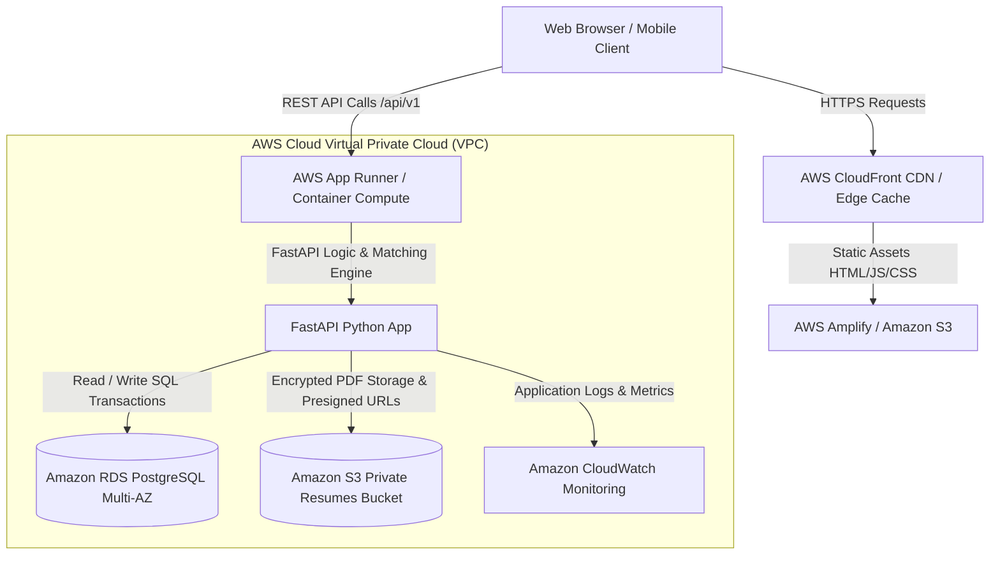
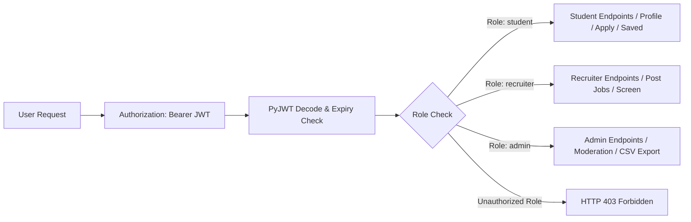

# CareerCloud — Cloud System Architecture Specification

## 1. Executive Summary

**CareerCloud** is a centralized, multi-tenant, cloud-native campus placement and job matching portal. Designed for academic institutions and enterprise talent acquisition, it seamlessly connects three primary stakeholders: **Students**, **Corporate Recruiters**, and **College Placement Officers**.

The platform is designed around cloud computing principles: stateless compute, decoupled object storage, managed relational database services, least-privilege security, and an explainable rule-based matching engine.

---

## 2. 3-Tier Cloud Architecture Topology

The application is architected into three distinct cloud tiers:

### Tier 1: Client & Presentation Layer
* **Framework**: React 19 + TypeScript + Vite.
* **Styling**: Tailwind CSS with custom design system tokens.
* **Hosting**: AWS Amplify or Amazon S3 with AWS CloudFront CDN distribution.
* **Responsibilities**: Responsive UI/UX, client-side routing, JWT session state management, interactive Recharts dashboards, and in-app notifications.

### Tier 2: Application & Compute Layer
* **Runtime**: Python 3.11 / 3.14 Container with Uvicorn ASGI server.
* **Framework**: FastAPI (asynchronous REST API).
* **Hosting**: AWS App Runner or AWS Elastic Beanstalk.
* **Responsibilities**:
  * Role-Based Access Control (RBAC) with bcrypt password hashing and signed JWT validation.
  * Deterministic rule-based matching and candidate recommendation service.
  * Resume validation (file signature magic bytes, size limits, and sanitization).
  * Storage abstraction adapter (Local disk vs Amazon S3).
  * Security audit logging and institutional metrics aggregation.

### Tier 3: Persistence & Object Storage Layer
* **Relational Database**: Amazon RDS for PostgreSQL.
  * ACID-compliant transactional consistency.
  * Foreign key referential integrity with cascading updates.
  * Automated backups and point-in-time recovery.
* **Private Object Storage**: Amazon S3 (Server-Side Encryption with AES-256).
  * Student resumes are stored with UUID keys rather than user-provided filenames.
  * Direct public access is completely blocked (`BlockPublicAcls`, `BlockPublicPolicy`).
  * Authorized access is granted strictly via short-lived (1-hour) presigned URLs.

---

## 3. Explainable Rule-Based Matching Algorithm

Rather than utilizing an unverified or opaque black-box model, CareerCloud implements an explainable, deterministic mathematical algorithm:

$$\text{Total Score} = \text{Skills Score} (50) + \text{Dept Score} (20) + \text{CGPA Score} (15) + \text{Grad Batch Score} (15)$$

### Score Computation Breakdown:
1. **Technical Skills Alignment (50 Points)**:
   $$\text{Skills Score} = \left(\frac{|\text{Student Skills} \cap \text{Job Required Skills}|}{|\text{Job Required Skills}|}\right) \times 50$$
2. **Department / Major Compatibility (20 Points)**:
   * 20 points awarded if student's academic department is in the job's eligible departments list or if the role allows all majors; 0 points otherwise.
3. **Cumulative CGPA (15 Points - Hard Constraint)**:
   * If $\text{CGPA}_{\text{student}} < \text{CGPA}_{\text{min}}$, candidate is marked **Strictly Ineligible** ($\text{is\_eligible} = \text{false}$) and CGPA score is set to 0.
   * If $\text{CGPA}_{\text{student}} \ge \text{CGPA}_{\text{min}}$, 15 points are awarded.
4. **Graduation Batch (15 Points - Hard Constraint)**:
   * If student's graduation year is not in the job's eligible batches list, candidate is marked **Strictly Ineligible** ($\text{is\_eligible} = \text{false}$) and Batch score is set to 0.
   * If matched, 15 points are awarded.

---

## 4. Security & Role-Based Access Control (RBAC)

### Resume Access Security Matrix:
| Actor | Own Resume | Candidate Who Applied to Job | Stranger Candidate Resume |
| :--- | :---: | :---: | :---: |
| **Student** | ✅ Full Access | ❌ Forbidden | ❌ Forbidden (403) |
| **Recruiter** | ❌ N/A | ✅ Authorized Download | ❌ Forbidden (403) |
| **Placement Officer** | ✅ Authorized | ✅ Authorized | ✅ Authorized (Audit Logged) |

---

## 5. Storage Abstraction Layer

The application implements the Dependency Inversion Principle with an abstract `StorageService` interface:

* **Development Mode (`STORAGE_TYPE=local`)**: Stores files in `./uploads/resumes/` using UUID filenames. Enables students to test, run, and demonstrate without cloud setup.
* **Production Mode (`STORAGE_TYPE=s3`)**: Stores files in an Amazon S3 private bucket, generating temporary presigned download URLs for verified recruiters and placement officers.
