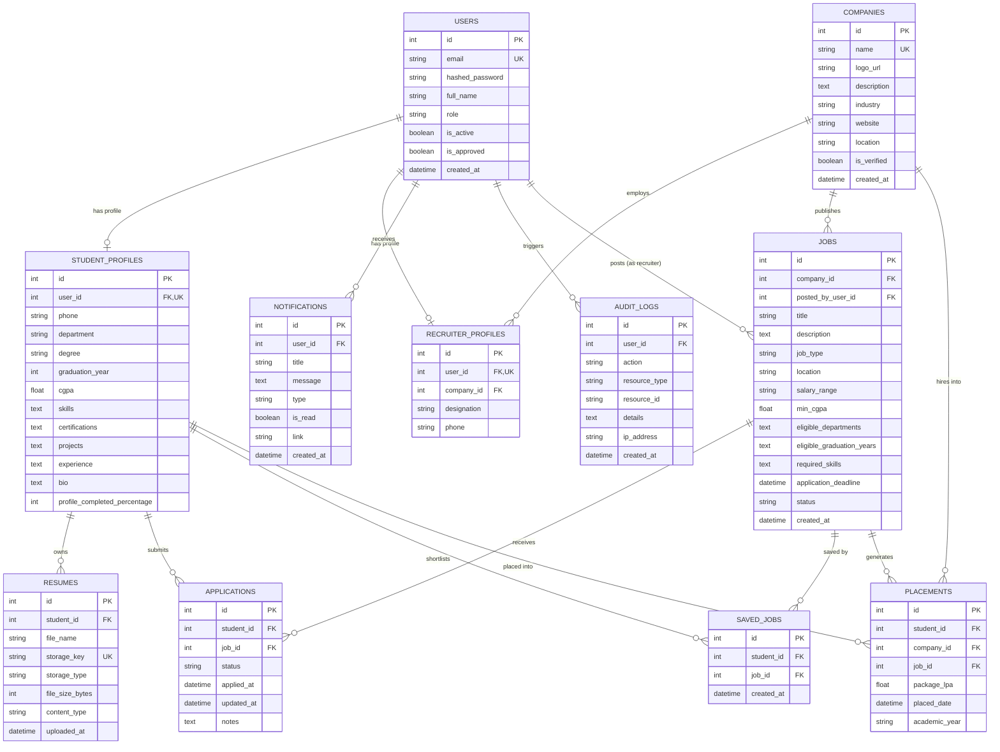

# CareerCloud — Relational Database Architecture

## 1. Entity-Relationship (ER) Diagram

---

## 2. Table Specifications & Constraints

### 1. `users`
* `id`: Integer primary key with autoincrement.
* `email`: VARCHAR(255), UNIQUE, INDEXED. Case-insensitive normalization applied at application level.
* `hashed_password`: VARCHAR(255) containing salted bcrypt cryptographic hash.
* `role`: VARCHAR(50) restricted to `'student'`, `'recruiter'`, or `'admin'`.
* `is_approved`: Boolean flag. Student accounts default to true; recruiter company accounts are reviewed by placement officers.

### 2. `student_profiles`
* `user_id`: Integer foreign key referencing `users.id` with `ON DELETE CASCADE`. Unique constraint enforces 1:1 mapping.
* `department`: VARCHAR(100), e.g., 'Computer Science & Engineering'.
* `cgpa`: Float with check constraint $0.0 \le \text{cgpa} \le 10.0$.
* `skills`: Comma-separated list of technical competencies evaluated by the matching service.

### 3. `jobs`
* `company_id`: Foreign key referencing `companies.id` with `ON DELETE CASCADE`.
* `min_cgpa`: Minimum eligibility requirement.
* `eligible_departments`: Comma-separated list of accepted majors.
* `eligible_graduation_years`: Comma-separated graduation cohorts.
* `status`: Active, closed, or flagged.

### 4. `applications`
* Composite uniqueness constraint: `UNIQUE (student_id, job_id)` prevents accidental or duplicate submissions.
* `status`: Enum string (`Applied`, `Shortlisted`, `Interview Scheduled`, `Selected`, `Rejected`, `Withdrawn`).

### 5. `resumes`
* `storage_key`: UNIQUE UUID key preventing collisions and directory traversal.
* `storage_type`: `'local'` or `'s3'`.
* Resumes are protected by row-level application checks ensuring strict student and authorized recruiter access.

### 6. `placements`
* Records final accepted recruitment offers with package (LPA) and academic cohort for institutional accreditation statistics.
